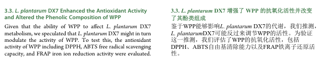
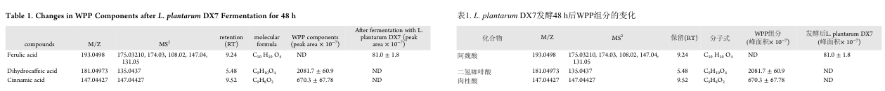
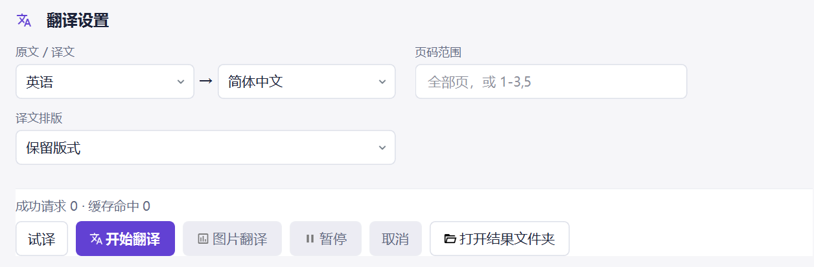

# 浮译 LinguaFloat

浮译是一个 Windows 桌面翻译工具。读英文论文时，可以把 PDF 做成左右对照：左边看原文，右边读中文，遇到不确定的术语就对着看。不需要翻整篇时，选中一句话就能译；游戏对话或图片里的字选不中，也可以在屏幕上框选。

[下载 Windows x64 便携版（v0.19.9）](https://github.com/astatineat2/linguafloat-releases/releases/tag/v0.19.9) · [使用指南](https://github.com/astatineat2/linguafloat-releases/blob/main/使用指南.md) · [更新日志](CHANGELOG.md)

## 翻出来是什么样

上图是从双语 PDF 里截出的一段。除了左右对照，也可以只导出译文，或让原文页和译文页交替排列。

独立表格随正文一起翻。比如这张表里，左边的 *Ferulic acid* 在右边是“阿魏酸”，同一行的数值还在，方便逐列核对。图注也随正文翻译；**图里面的字另算**，正文完成后再点“图片翻译”。密集图如果排不下译文，就保留原图。复杂表格和公式仍建议对照原文检查。

两张对照图均为同一篇[论文](https://doi.org/10.1021/acs.jafc.5c14462)第 6 页的局部，仅用于展示排版。

## 第一次用

已有用户可以打开“帮助与更新”，检查并安装稳定版，无需重新解压。

1. 在下载页选 `LinguaFloat-v0.19.9-win-x64.zip`，完整解压后打开 `LinguaFloat.exe`。不用装 Python，也别只把 EXE 单独拿出来。
2. 在“配置设置”里填入自己的翻译服务和 API Key。屏幕文字识别在本机运行；要翻译的内容会发给你选的服务商，费用按对方的规则计算。
3. 打开“文件翻译”，添加文档。第一次可以只填一两页试试，确认排版合适再翻整篇。除了 PDF，也支持 Word（DOCX）和 PowerPoint（PPTX）。

平时读网页或聊天，不必添加文件。选中文字后用快捷键翻译；要回消息，可以先把中文译成外语，检查后再复制发送。需要读游戏字幕时，框选字幕出现的位置即可；独占全屏或受保护的窗口可能截不到画面。

**PDF 局部选字：** 原译交替导出时，符合条件的译页改用页面文字，便于局部拖选。已有 PDF 需要重新生成；WPS 整页误选仍待实机确认。

## 源码与许可

浮译的源码使用 [AGPL-3.0-only](LICENSE)。PDF 处理用到了 BabelDOC、PDFMathTranslate-next 和 PyMuPDF，屏幕文字识别使用 RapidOCR 和 ONNX Runtime，桌面界面使用 PySide6。各组件的许可见[第三方声明](THIRD_PARTY_NOTICES.md)。每个公开版本对应的源码随[发行附件](https://github.com/astatineat2/linguafloat-releases/releases)提供。
